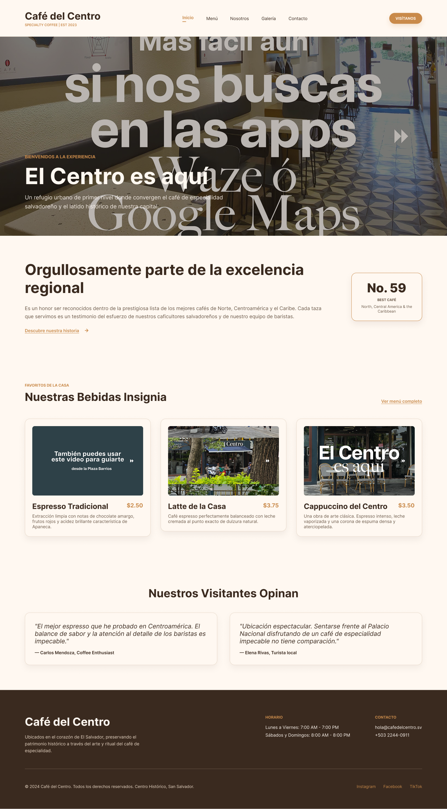
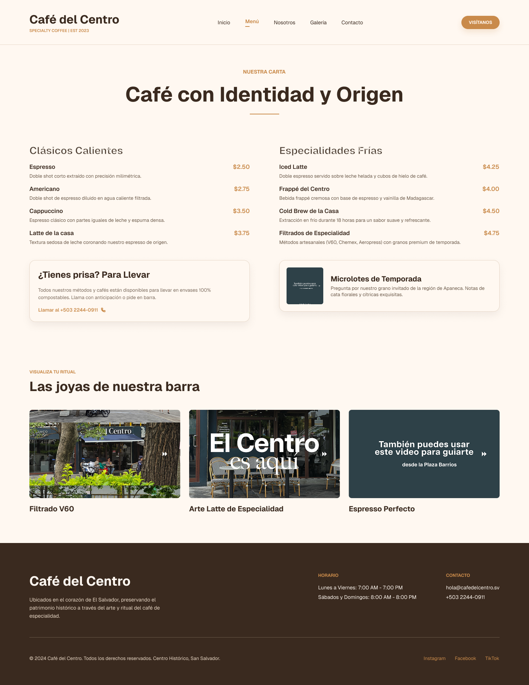
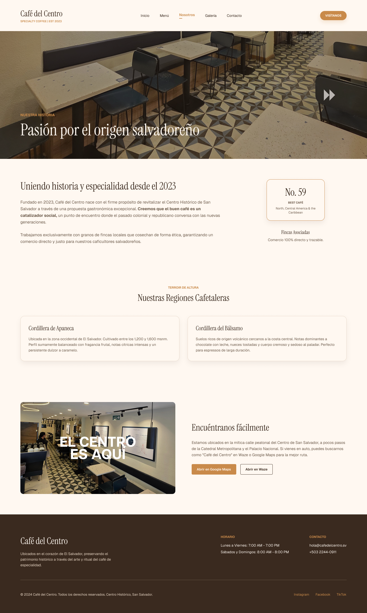
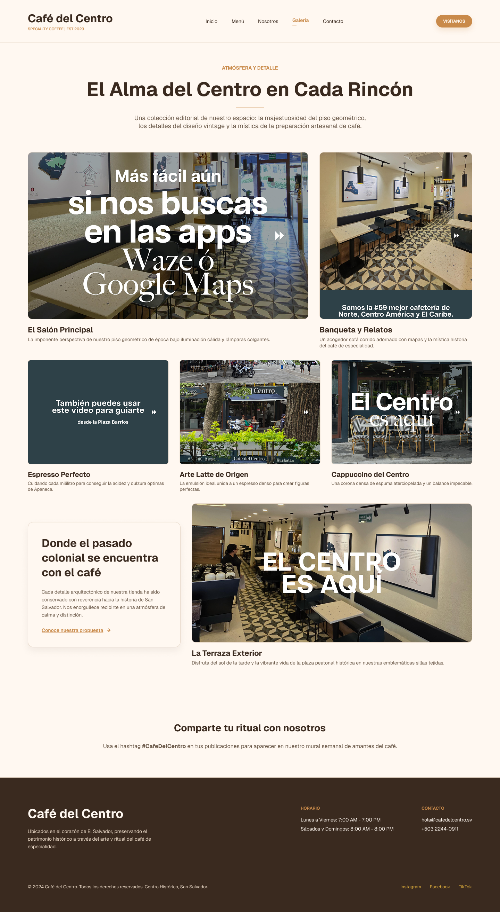
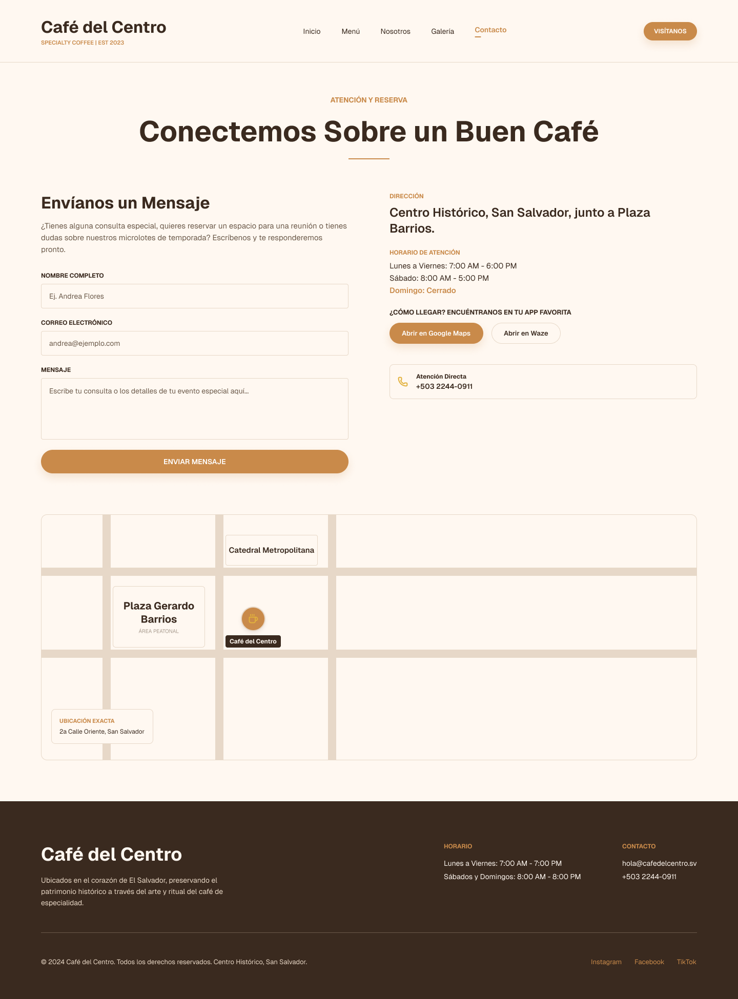
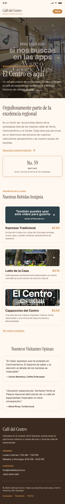
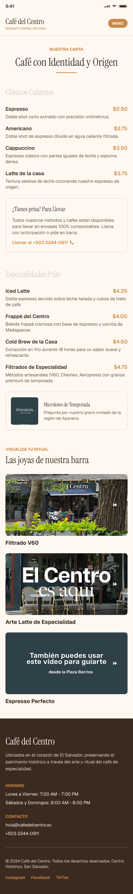
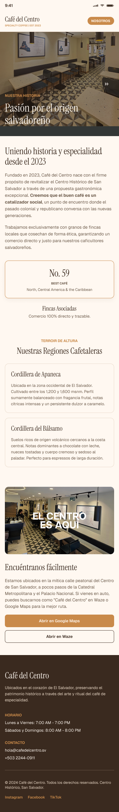
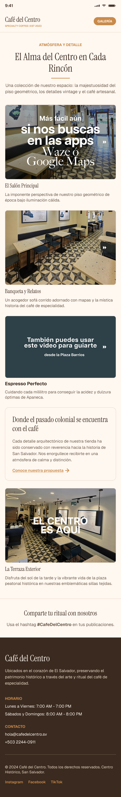
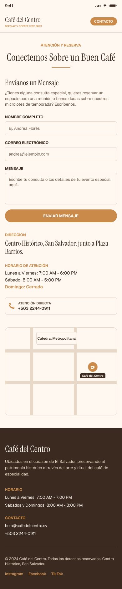

# Café del Centro · Aplicación web de pedidos

Aplicación web de pedidos para **Café del Centro**, cafetería de especialidad ubicada en el Centro Histórico de San Salvador. El cliente arma su pedido eligiendo el tamaño del vaso con el precio calculado en tiempo real, paga en efectivo o con tarjeta y acumula puntos de fidelidad. El administrador gestiona el catálogo, cambia el estado de los pedidos y consulta un panel de reportes.

La versión web comparte autenticación, base de datos y reglas de negocio con la **app móvil**: un pedido hecho desde el teléfono aparece al instante en el panel del administrador, y cuando este lo marca como listo, el cliente lo ve actualizado en su teléfono.

Proyecto de la asignatura **Diseño y Programación de Software Multiplataforma (DPS941)**, Universidad Don Bosco, ciclo 02-2026.

## Enlaces

| | |
|---|---|
| Aplicación web desplegada | https://codehub-cafe-del-centro-web.vercel.app |
| Repositorio de la app móvil | https://github.com/CristianHF29/codehub-cafe-del-centro-mobile |
| Diseño en Figma (web y móvil) | https://www.figma.com/design/WcpCQgZSYKtXfmcroyKasO/vistas-mobil |

### Credenciales de prueba

| Rol | Correo | Contraseña |
|---|---|---|
| Administrador | [CORREO ADMIN] | [CONTRASEÑA ADMIN] |
| Cliente | Crear una cuenta desde `/registro` o entrar con Google | |

Toda cuenta nueva se crea con rol de cliente. El rol de administrador solo se asigna desde la consola de Firebase.

## Mockups de Figma

### Versión web (escritorio)

| Inicio | Menú |
|---|---|
|  |  |

| Nosotros | Galería | Contacto |
|---|---|---|
|  |  |  |

### Versión móvil

| Inicio | Menú | Nosotros | Galería | Contacto |
|---|---|---|---|---|
|  |  |  |  |  |

## Funcionalidades

### Cliente

- Registro e inicio de sesión con correo o con cuenta de Google.
- Menú con fotos y selección de tamaño de vaso (16, 20, 24 y 32 oz) con precio dinámico.
- Carrito con control de cantidades.
- Pago en efectivo o con tarjeta. El pago con tarjeta es una simulación: valida el número con el algoritmo de Luhn, la fecha y el CVV, pero no cobra nada y solo guarda los últimos 4 dígitos.
- Confirmación animada del pedido con los puntos ganados.
- Puntos de fidelidad: 1 punto por cada dólar completo.
- Historial de pedidos con su estado actualizado en tiempo real.

### Administrador

- Gestión del catálogo: crear, editar, ocultar y eliminar productos, con carga de imágenes.
- Gestión de pedidos de la web y de la app móvil, con el nombre del cliente, el detalle, el método de pago y el cambio de estado (pendiente, listo, entregado).
- Panel de reportes: ventas totales, ticket promedio, clientes con pedidos, ranking de productos más vendidos, pedidos por estado y actividad de los últimos siete días.

### Control de acceso

Las rutas `/menu` y `/dashboard` requieren sesión activa. El dashboard es exclusivo del administrador; un cliente que intente entrar es redirigido al menú.

## Arquitectura multiplataforma

La web y la app móvil usan **el mismo proyecto de Firebase**, por lo que comparten:

- **Autenticación:** la misma cuenta, con correo o con Google, sirve en las dos plataformas.
- **Datos:** las mismas colecciones de Cloud Firestore.
- **Lógica de negocio:** el mismo formato de pedido, el mismo cálculo de puntos y el mismo flujo de estados.
- **Seguridad:** las mismas reglas de Firestore, incluidas en [`firestore.rules`](firestore.rules).

```
              ┌──────────────────────────┐
              │   Firebase Authentication│
              │   (correo y Google)      │
              └─────────────┬────────────┘
                            │
   ┌────────────────┐       │       ┌──────────────────┐
   │  Web (Next.js) │◄──────┼──────►│ Móvil (React     │
   │  cliente+admin │       │       │ Native, cliente) │
   └───────┬────────┘       │       └────────┬─────────┘
           │        ┌───────┴────────┐       │
           └───────►│ Cloud Firestore│◄──────┘
                    │ usuarios       │
                    │ productos      │
                    │ pedidos        │
                    └────────────────┘
```

| Colección | Contenido |
|---|---|
| `usuarios` | Nombre, correo, rol (`cliente` o `admin`) y puntos |
| `productos` | Nombre, descripción, categoría, imagen, precios por tamaño, disponibilidad y orden |
| `pedidos` | Cliente, productos, total, estado, fecha y método de pago |

Los cambios se escuchan en tiempo real con `onSnapshot`, así que no hace falta recargar la página. El pedido y la suma de puntos se guardan en una **transacción**: se aplican los dos o ninguno.

### Capas del proyecto web

- **Páginas y componentes** (`app/`, `components/`): solo presentación e interacción; no acceden a Firebase directamente.
- **Estado global** (`context/`): `SesionContext` maneja la sesión y el perfil del usuario; `AppContext` maneja el catálogo, el carrito y los pedidos.
- **Servicios** (`services/`): única capa que se comunica con Firebase, separada por recurso (autenticación, productos, pedidos y usuarios).

### Seguridad

- Las reglas de Firestore no están en modo de prueba: cada cliente solo puede leer sus propios pedidos y su perfil.
- Nadie puede asignarse el rol de administrador ni modificar sus puntos más allá de sumar los de un pedido.
- Solo el administrador puede editar el catálogo y cambiar el estado de los pedidos, y únicamente ese campo.
- Las contraseñas las maneja Firebase Authentication; el proyecto nunca las guarda.
- El token de Vercel Blob vive en variables de entorno y no se sube al repositorio.

## Tecnologías

- Next.js 16 con App Router y React 19
- Tailwind CSS 4
- Context API para el estado global
- Firebase Authentication (correo y Google)
- Cloud Firestore
- Vercel Blob para las imágenes del catálogo
- Despliegue continuo en Vercel

## Instalación

```bash
git clone https://github.com/CristianHF29/codehub-cafe-del-centro-web.git
cd codehub-cafe-del-centro-web
npm install
```

Para subir imágenes desde el panel de administración, creá un archivo `.env.local` en la raíz con el token de Vercel Blob:

```
BLOB_READ_WRITE_TOKEN=tu_token
```

Después arrancá el servidor:

```bash
npm run dev
```

La aplicación queda disponible en http://localhost:3000

## Estructura del proyecto

```
app/
  api/upload/        Subida de imágenes a Vercel Blob
  login/             Inicio de sesión (correo y Google)
  registro/          Registro de clientes
  menu/              Menú del cliente y panel de administración
  dashboard/         Reportes del administrador
  customer-home.tsx  Página de inicio pública
components/          Carrito, pago, historial, pedidos y catálogo
context/             Sesión y estado global
services/            Conexión con Firebase por recurso
utils/               Validación de tarjeta
docs/mockups/        Mockups de Figma
firestore.rules      Reglas de seguridad de Firestore
```

## Equipo CodeHub (T-010)

| Integrante | Carnet | Aporte |
|---|---|---|
| Cristian Arturo Hernández Flores | hf252375 | API y capa de servicios (Etapa 2), app móvil (Etapa 3) e integración final con Firebase |

## Licencia

Este proyecto está bajo la licencia [Creative Commons Atribución-NoComercial 4.0 Internacional (CC BY-NC 4.0)](https://creativecommons.org/licenses/by-nc/4.0/deed.es). Ver el archivo [LICENSE](LICENSE).